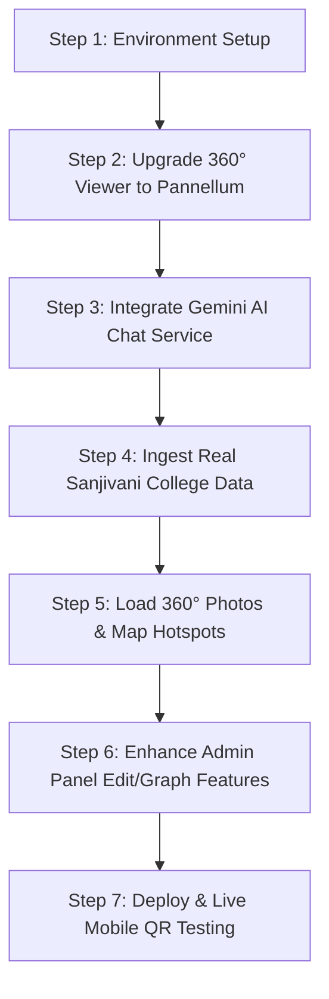

# CampusConnect AI — Project Audit, Feature Status & Requirements Roadmap

> **Document Purpose:** This document provides a comprehensive, item-by-item comparison between the architectural specifications in [`CAMPUSCONNECT_AI_PROJECT_CONCEPT.md`](./CAMPUSCONNECT_AI_PROJECT_CONCEPT.md) (along with the execution checklist in [`CAMPUSCONNECT_AI_IMPLEMENTATION_PLAN.md`](./CAMPUSCONNECT_AI_IMPLEMENTATION_PLAN.md)) and the current state of the codebase. It clearly outlines **what is completed**, **what remains to be built**, and **the exact information and assets you need to provide** to bring CampusConnect AI to 100% completion.

---

## 1. Executive Summary

| Category | Specification in Concept Document | Current Implementation State | Completion % |
| :--- | :--- | :--- | :---: |
| **1. Visitor Web UI** | 5 core screens: Welcome, Chat Assistant, Destination Details, 360° Navigation, Reached Destination. Mobile-first design. | All 5 screens are built with React, Vite, Lucide-react, and Tailwind CSS. Modern, responsive card-based layout. | **95%** |
| **2. QR Code Access** | Entrance QR code encoding start location (e.g. `/?start=node-main-gate`), zero app install. | Dedicated `/qr` screen using `qrcode.react` generating dynamic scannable QR. URL parameter `?start=` parsed and handled. | **90%** |
| **3. AI Chatbot & NLP** | Natural language queries, intent classification, entity extraction, clarification handling, LLM backend with verified database retrieval. | Rule-based regex/keyword engine (`intentService.js`) detecting 6 intents and aliases. **LLM integration (Gemini/OpenAI) is NOT yet connected**. | **55%** |
| **4. Campus Navigation Graph** | Graph $G = (V, E)$, node models, edge weights/instructions, BFS/Dijkstra shortest path algorithm, turn-by-turn guidance. | BFS pathfinding engine in `navigationEngine.js` calculating node routes, step-by-step human instructions, and cumulative distances. | **85%** |
| **5. 360° Virtual Tour** | Interactive 360° panoramic sphere (Pannellum/Marzipano), click-and-drag view, embedded clickable directional arrows/hotspots. | **Placeholder only**: Flat SVG image slides with directional buttons. Interactive 360° sphere viewer is **NOT yet initialized in UI**, and real 360° photos are missing. | **40%** |
| **6. Campus Database** | Authoritative data store for Buildings, Floors, Locations, Faculty, Departments, Nav Nodes, Edges, Panoramas, Aliases. | Structured local JSON store with complete REST API CRUD layer. All current records are **sample/demo data** marked `[DEMO DATA]`. | **60%** |
| **7. Admin Management Panel** | Web portal to manage campus information, buildings, rooms, faculty, aliases, panoramas, and view visitor analytics. | Admin Login (`/admin`) and Dashboard (`/admin/dashboard`) with Location & Faculty CRUD and high-level stats. Node/edge/panoramas and analytics missing. | **65%** |
| **8. Voice Support** | Microphone button, speech-to-text input, and optional text-to-speech audio feedback. | Browser Web Speech API wired in `AssistantPage.jsx`. TTS audio feedback not yet implemented. | **50%** |
| **9. Infrastructure & Setup** | Runnable dev environment, `.env` security, zero credential leaks in client code. | Server and client code written, but `node_modules` and `backend/.env` are currently not installed/configured on disk. | **60%** |

---

## 2. Detailed Feature-by-Feature Comparison

### Module 1: QR Code Visitor Access
* **Concept Specification:**
  * Visitors scan physical QR codes located at campus entrances.
  * Web app opens immediately in mobile browser with zero app installation.
  * Start location auto-detected from query string (e.g., `?start=node-main-gate`).
* **Completed Work:**
  * ✅ Created [`frontend/src/pages/QRPage.jsx`](./frontend/src/pages/QRPage.jsx) rendering scannable QR code using `qrcode.react`.
  * ✅ [`WelcomePage.jsx`](./frontend/src/pages/WelcomePage.jsx) and [`AssistantPage.jsx`](./frontend/src/pages/AssistantPage.jsx) extract `start` query parameter and pass it into route calculations.
  * ✅ Default fallback to `node-main-gate` if no query parameter is provided.
* **Remaining Work & Gaps:**
  * ⚠️ QR code currently uses `window.location.origin` (which defaults to `http://localhost:5173` during local dev). Mobile phones on the same WiFi network cannot open `localhost` without your machine's LAN IP (e.g., `http://192.168.x.x:5173`) or a tunnel URL (ngrok/Cloudflare).
  * ⚠️ Admin cannot generate QR codes for different gates (e.g. Back Gate, Library Entrance, Hostel Gate).

---

### Module 2: AI Chatbot & Natural Language Processing (NLP)
* **Concept Specification:**
  * Natural language conversation: "Where can I pay my admission fees?", "Take me to Prof. ABC", "Where is the Computer department?".
  * Intent classification + Entity extraction (extracting destination name and intent).
  * Controlled retrieval architecture: The LLM does **not** hallucinate room numbers or routes; it maps requests to verified database records.
  * Suggestions and clarification questions when queries are ambiguous.
* **Completed Work:**
  * ✅ Rule-based NLP engine implemented in [`backend/services/intentService.js`](./backend/services/intentService.js).
  * ✅ Intent categories implemented: `FIND_LOCATION`, `FIND_FACULTY`, `FIND_DEPARTMENT`, `FIND_SERVICE`, `GENERAL_INFORMATION`, `UNKNOWN`.
  * ✅ Multi-keyword and alias matching (e.g. matching "fees", "fee counter", "pay" to "Accounts Office").
  * ✅ Clarification response when multiple destinations match a query.
  * ✅ Suggested destinations chips on [`AssistantPage.jsx`](./frontend/src/pages/AssistantPage.jsx).
* **Remaining Work & Gaps:**
  * ❌ **Real LLM Integration (Phase 10):** `backend/services/aiService.js` has not been created yet. The chatbot currently relies exclusively on exact string/regex matches.
  * ❌ Phrasing that deviates from hardcoded regex patterns (e.g. colloquial phrasing, typos, or Marathi/Hindi transliterated queries) will trigger the fallback response.
  * ❌ Missing Gemini / OpenAI API integration in [`backend/routes/chat.js`](./backend/routes/chat.js).

---

### Module 3: Campus Navigation Engine (Graph Pathfinding)
* **Concept Specification:**
  * Graph $G = (V, E)$ where vertices are physical nodes (gates, entrances, corridor turns, staircases, offices) and edges represent traversable paths.
  * Shortest path calculation (BFS / Dijkstra).
  * Human-readable step-by-step guidance instructions.
* **Completed Work:**
  * ✅ Adjacency-list graph builder and BFS shortest-path algorithm in [`backend/services/navigationEngine.js`](./backend/services/navigationEngine.js).
  * ✅ 16 navigation nodes defined in [`data/navigation-nodes.json`](./data/navigation-nodes.json).
  * ✅ 30 directed edges with human instructions and distances in [`data/navigation-edges.json`](./data/navigation-edges.json).
  * ✅ Verified test routes:
    * Route 1: Main Gate → Reception → Admin Entrance → Ground Floor Corridor → Admission Office (5 steps, 145m).
    * Route 2: Main Gate → Reception → Main Academic Building → Staircase → First Floor Corridor → Computer Dept → HOD Cabin (7 steps).
  * ✅ [`DestinationPage.jsx`](./frontend/src/pages/DestinationPage.jsx) displays step count, total estimated distance, turn-by-turn instruction list, and direct CTA to start navigation.
* **Remaining Work & Gaps:**
  * ⚠️ Graph is unweighted BFS (finds fewest node hops, not strictly shortest metric distance, though adequate for small prototypes).
  * ⚠️ Graph currently covers only the 2 sample demonstration routes. The rest of the Sanjivani College campus (other wings, departments, workshops, canteen, library floor) has not been mapped into nodes and edges.

---

### Module 4: 360° Virtual Tour & Visual Navigation
* **Concept Specification:**
  * Google Street View-like indoor 360° virtual navigation.
  * Interactive panorama viewer (e.g. Pannellum) allowing user to drag, rotate, pitch, yaw, and zoom in 360° space.
  * Directional hotspots placed directly inside the spherical view pointing toward the next node.
  * Seamless transition from one 360° node to the next as the user moves along the path.
* **Completed Work:**
  * ✅ Navigation workflow state management: Route calculation → Panorama sequence array (`panoramaChain`) → Step progression → Reached page.
  * ✅ HUD overlay in [`NavigationPage.jsx`](./frontend/src/pages/NavigationPage.jsx) with progress bar, step counter, destination tag, exit button, and directional action buttons.
  * ✅ 5 SVG placeholder panoramas (`sample-outdoor.svg`, `sample-indoor.svg`, etc.) in `frontend/public/panoramas/`.
* **Remaining Work & Gaps:**
  * ❌ **Major Gap — Interactive 360° Sphere Viewer:** In [`NavigationPage.jsx`](./frontend/src/pages/NavigationPage.jsx), the viewer is currently just a standard 2D flat `` element showing a static SVG graphic. While `pannellum` is listed in `package.json`, the real 360° spherical canvas viewer was never instantiated!
  * ❌ **Real 360° Photography (Phase 14):** No actual 360° equirectangular JPEG photographs of Sanjivani College exist yet.
  * ❌ Spherical hotspot coordinates (`pitch`, `yaw`) are defined in JSON, but are not rendered as interactive pins on top of the 3D panorama canvas.

---

### Module 5: Campus Information Database
* **Concept Specification:**
  * Authoritative data layer holding buildings, floors, rooms, departments, faculty, aliases, and navigation coordinates.
  * Prototype uses structured JSON; upgradeable to MongoDB.
* **Completed Work:**
  * ✅ [`data/buildings.json`](./data/buildings.json) (3 demo buildings).
  * ✅ [`data/floors.json`](./data/floors.json) (6 demo floors).
  * ✅ [`data/locations.json`](./data/locations.json) (12 demo locations with aliases).
  * ✅ [`data/departments.json`](./data/departments.json) (3 demo departments).
  * ✅ [`data/faculty.json`](./data/faculty.json) (2 demo faculty members).
  * ✅ [`backend/services/dataStore.js`](./backend/services/dataStore.js) for read/write file persistence.
  * ✅ REST endpoints for all entities.
* **Remaining Work & Gaps:**
  * ⚠️ All data entries are currently fictional sample records tagged with `[DEMO DATA]`.
  * ⚠️ Needs real Sanjivani College data (actual building names, department locations, HOD names, room numbers, fee counter timings, etc.).
  * ⚠️ File-based JSON does not support atomic concurrency or transactions (fine for demo/prototype, but MongoDB Atlas needed for scaled deployment).

---

### Module 6: Admin Management Panel
* **Concept Specification:**
  * Secure administrative portal for non-technical campus coordinators to add/update locations, faculty, aliases, and panorama links without editing code.
  * View visitor search query analytics and feedback.
* **Completed Work:**
  * ✅ Admin login screen at [`AdminLoginPage.jsx`](./frontend/src/pages/AdminLoginPage.jsx).
  * ✅ Admin dashboard at [`AdminDashboard.jsx`](./frontend/src/pages/AdminDashboard.jsx) with metrics summary (building count, location count, faculty count, node count).
  * ✅ Location Management: View all locations, Add new location with aliases, Delete location.
  * ✅ Faculty Management: View all faculty members, Add faculty, Delete faculty.
  * ✅ Authentication middleware in [`backend/middleware/requireAdmin.js`](./backend/middleware/requireAdmin.js).
* **Remaining Work & Gaps:**
  * ⚠️ Missing Edit/Update modal in the frontend (the PUT API exists in the backend, but the frontend only has "Add" and "Delete").
  * ⚠️ Cannot manage Buildings, Floors, Navigation Nodes, Edges, or Panoramas from the UI (must edit JSON files directly).
  * ⚠️ Missing Visitor Search Analytics & Query History (concept mentions tracking common search terms and failed queries).
  * ⚠️ Admin token is a simple Base64 string; needs standard JWT signature before production.

---

### Module 7: Voice Support & Accessibility
* **Concept Specification:**
  * Voice query input for visitors who prefer speaking over typing.
  * Text-to-speech (TTS) voice announcements for navigation steps.
* **Completed Work:**
  * ✅ SpeechRecognition (Web Speech API) wired to the microphone button in [`AssistantPage.jsx`](./frontend/src/pages/AssistantPage.jsx).
* **Remaining Work & Gaps:**
  * ⚠️ Browser Web Speech API only functions over `https://` or `localhost`. When testing on a real mobile device over local LAN (`http://192.168.x.x`), browsers will block microphone access unless an SSL certificate or tunnel is used.
  * ❌ Text-to-speech (TTS) audio narration is not yet implemented.

---

### Module 8: Security, Environment & Deployment
* **Concept Specification:**
  * Credentials stored in environment variables, `.env` git-ignored, production build clean, responsive mobile UX.
* **Completed Work:**
  * ✅ `.env` added to `.gitignore`.
  * ✅ Modular Express route architecture and Vite React setup.
* **Remaining Work & Gaps:**
  * ❌ `backend/.env` file is missing on disk (needs to be created with port and credentials).
  * ❌ `node_modules` are not installed in either `backend/` or `frontend/` on this machine.
  * ❌ No public deployment (e.g. Vercel for frontend + Render/Railway for backend) to allow scanning the QR code from any external mobile phone.

---

## 3. Summary of Status by Phase (Implementation Plan Alignment)

| Phase | Description | Status | What is Missing to Complete |
| :---: | :--- | :---: | :--- |
| **0** | Workspace Inspection & Planning | **DONE (100%)** | All initial planning docs established. |
| **1** | Application Foundation | **90%** | Dependencies need `npm install`; `.env` file needed. |
| **2** | Professional Visitor UI | **95%** | Minor polish, CSS transitions. |
| **3** | Campus Data Layer | **75%** | Replace `[DEMO DATA]` with real Sanjivani College data. |
| **4** | Destination Search & Basic Chat | **90%** | Works well with regex; ready for LLM upgrade. |
| **5** | Campus Navigation Engine (BFS) | **85%** | Works for 2 demo routes; needs full campus graph. |
| **6** | Route Result UI | **100%** | Full cards, step list, distance calculation complete. |
| **7** | 360° Virtual Tour Engine | **40%** | **Need interactive Pannellum sphere viewer + hotspots.** |
| **8** | Connect Routing to 360° Navigation | **80%** | Route-to-step-to-destination logic works; needs Pannellum integration. |
| **9** | QR Code Entry | **90%** | QR works; needs live network IP or deployment URL. |
| **10** | **AI / LLM Integration (Gemini/OpenAI)** | **0%** | **Need API Key from user + `aiService.js`**. |
| **11** | Voice Support | **50%** | STT works in Chrome localhost; need SSL/tunnel for mobile & TTS. |
| **12** | Admin Management Panel | **70%** | Add Edit modals; Node/Edge/Pano editor; Visitor query log. |
| **13** | **Real Campus Data Preparation** | **15%** | **Need verified data from user for Sanjivani College.** |
| **14** | **360° Campus Data Collection** | **10%** | **Need real equirectangular 360° photos from user.** |
| **15** | Error Handling & Fallbacks | **75%** | Missing route/search fallbacks exist; need offline fallback. |
| **16** | Full Testing | **30%** | Tested locally; need mobile device end-to-end testing. |
| **17** | Security Review | **60%** | Replace Base64 token with JWT; input sanitization. |
| **18** | **Deployment Preparation** | **20%** | Deploy to Vercel/Render so anyone can scan QR code anywhere. |
| **19** | Final Demo Script & Preparation | **50%** | 2 demo paths ready; needs final practice run. |
| **20** | Academic Documentation & Report | **40%** | Concept and implementation plan ready; needs report/PPT. |
| **21** | Final Quality Gate | **Pending** | Depends on phases 10, 13, 14, and 18. |

---

## 4. What is Required From You (The User)

To complete the project 100%, please provide the following details and assets. You can provide them in parts:

### Requirement 1: AI Provider API Key (For Phase 10)
To enable real natural language conversation with the AI chatbot:
* **What is needed:** A **Google Gemini API Key** (recommended because it has a generous free tier) or an **OpenAI API Key**.
* **How to get it:**
  * Gemini: Visit [Google AI Studio](https://aistudio.google.com/), click "Create API Key", and copy the key.
* **Once provided:** I will build `backend/services/aiService.js`, configure the prompt with strict campus entity extraction, and integrate it into the chat pipeline with automatic fallback.

---

### Requirement 2: Real Campus Information for Sanjivani College (For Phase 13)
The application currently uses sample demo data. To make it a true Sanjivani College of Engineering system, provide details for the key locations you want to demonstrate:

#### A. Buildings & Floors
* What are the main buildings to include? (e.g., *Main Academic Building, Administrative Block, Mechanical Workshop, Library Building, MBA Block*).
* How many floors does each have? (e.g., *Ground, 1st, 2nd, 3rd*).

#### B. Key Offices & Visitor Destinations
For each location, provide:
1. **Name:** (e.g., *Admission Cell, Student Section, Accounts & Fees Counter, Examination Cell, Principal Office, T&P / Placement Cell, Central Library, Canteen, Auditorium*).
2. **Building & Floor:** (e.g., *Admin Building - Ground Floor*).
3. **Room Number:** (e.g., *Room 102*).
4. **Common names / aliases visitors might ask for:** (e.g. for Accounts: *"fees", "fee payment", "shikshan shulka", "cash counter", "challan"*).

#### C. Department & Faculty Details
* Which departments to include? (e.g., *Computer Engineering, IT, Mechanical, Civil, E&TC, AIML*).
* Specific faculty to feature in the demo:
  * Name (e.g., *Dr. X, HOD Computer Engineering*).
  * Designation.
  * Cabin location / Room number.

---

### Requirement 3: 360° Campus Panoramas (For Phase 14)
To create the genuine 360° virtual walking tour:

#### Option A: If you can take real 360° photos at the campus
* **Capture points:** Walk a continuous path and take 360° photos at each junction:
  1. Main Entrance Gate
  2. Security / Reception Desk
  3. Building Entrance Porch
  4. Ground Floor Main Corridor
  5. Staircase / Lift Lobby
  6. First Floor Corridor
  7. Department Entrance / HOD Cabin / Admission Office
* **Format required:** **Equirectangular 360° JPEG** (aspect ratio 2:1, e.g. $4096 \times 2048$ or $2048 \times 1024$).
* **Equipment to use:** A 360° camera (Insta360, Ricoh Theta) OR a smartphone using the Google Street View / Photosphere app / Panorama 360 app.

#### Option B: If real 360° campus photos are not yet available
* **Alternative:** Let me know, and I can generate realistic high-resolution equirectangular mock 360° campus scenes for each node using AI image generation or curated college campus equirectangular assets.
* This allows us to fully build and test the 360° Pannellum sphere navigation immediately without waiting for on-site photography!

---

### Requirement 4: Technical & Hosting Preferences
Please confirm your preference on:
1. **Interactive 360° Viewer:** We will integrate **Pannellum** into `NavigationPage.jsx` so users can touch/drag to look in all directions with interactive floating arrow hotspots. *(Confirm if Pannellum is preferred)*.
2. **Hosting / QR Code Testing:**
   * Do you want to test on your own mobile phone via local WiFi (LAN IP)?
   * Or do you want a free live deployment (e.g. Vercel for frontend + Render for backend) so anyone can scan the QR code from anywhere?

---

## 5. Next Immediate Action Plan

Once you review this document:

1. **Step 1 (Immediate Code Fixes):**
   * Run `npm install` in both `backend/` and `frontend/`.
   * Create `backend/.env` with configuration.
2. **Step 2 (360° Viewer Upgrade):**
   * Replace the flat `` in `NavigationPage.jsx` with a real interactive **Pannellum 360° sphere viewer** supporting drag, zoom, and directional hotspots.
3. **Step 3 (AI Integration):**
   * Implement `backend/services/aiService.js` (using the Gemini API key you provide) with automatic fallback to `intentService.js`.
4. **Step 4 (Data Ingestion):**
   * Replace `data/*.json` files with your real Sanjivani College buildings, offices, departments, and faculty.
5. **Step 5 (Panoramas & Hotspots):**
   * Add the 360° equirectangular photos (real or simulated) into `frontend/public/panoramas/` and link the navigation nodes.
6. **Step 6 (Admin Enhancements):**
   * Add Edit modals and Graph/Pano inspection in the Admin panel.
7. **Step 7 (Mobile QR Verification & Presentation):**
   * Test the complete flow from phone QR scan to 360° destination arrival.
